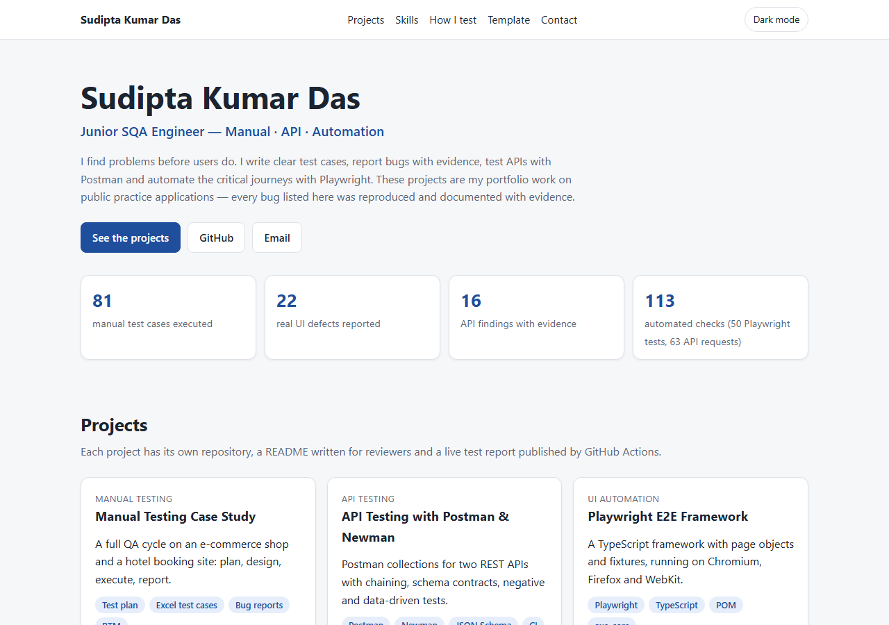
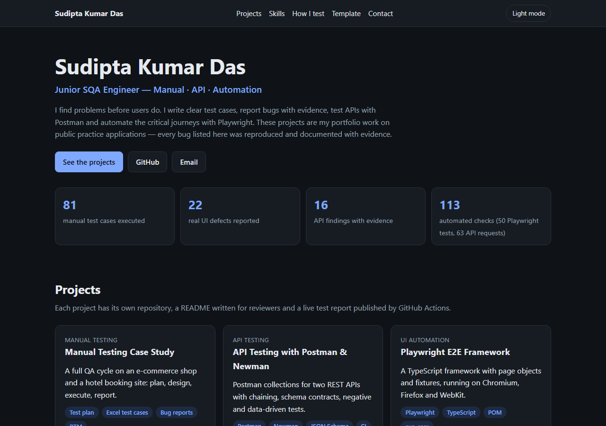
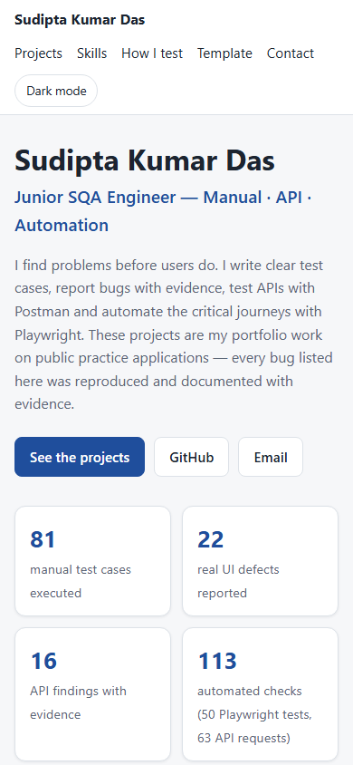

# SQA Portfolio Hub

The landing page for my Software Quality Assurance portfolio — one place that links every project, its
repository and its live test report.

[](https://github.com/the-sudipta/sqa-portfolio-hub/actions/workflows/pages.yml)
[](https://the-sudipta.github.io/sqa-portfolio-hub/)
[](LICENSE)

**Live:** https://the-sudipta.github.io/sqa-portfolio-hub/

## What this project shows

- A recruiter-friendly overview: role, numbers, one card per project with what was tested and links to the
  code and the live report.
- A skills matrix that points to the project where each skill can be seen.
- My testing process from requirement analysis to the final report.
- A downloadable Excel **test case template** (dropdowns for status, severity, priority and technique).
- The site tests itself: a Playwright link checker runs after every deployment and weekly.

## Tech stack

Plain HTML and CSS (responsive, light/dark theme that follows the system and can be toggled) · a few lines
of JavaScript for the theme toggle · Playwright for the link, theme and mobile-layout checks · exceljs for the
template · GitHub Actions + Pages.

## Project structure

```
sqa-portfolio-hub/
├─ index.html                     # the page
├─ assets/css/style.css           # layout, light/dark tokens
├─ assets/js/theme.js             # theme toggle
├─ assets/files/SQA_Test_Case_Template.xlsx
├─ scripts/build-template.js      # builds the Excel template
├─ tests/links.spec.ts            # link checker, theme toggle, 375 px layout
├─ profile-readme.md              # content for my GitHub profile README
└─ .github/workflows/pages.yml    # deploy, then check links on the live site
```

## How to run

```powershell
npm ci
npx playwright install chromium
npm test                        # checks the local index.html
$env:SITE_URL="https://the-sudipta.github.io/sqa-portfolio-hub/"; npm test   # checks the live site
npm run build:template          # rebuilds the Excel template
```

Open `index.html` directly in a browser to view the site locally.

## Checks

| Check | What it verifies |
|---|---|
| Link checker | Every anchor exists, local files exist, external links answer below HTTP 400, e-mail links are well formed |
| Theme toggle | The button switches between light and dark |
| Mobile layout | No horizontal scroll at 375 px |

## Screenshots

| Light | Dark | Mobile |
|---|---|---|
|  |  |  |

## Author

**Sudipta Kumar Das** — Junior SQA Engineer (manual, API, automation) · [GitHub](https://github.com/the-sudipta)

Copyright © 2026 Sudipta Kumar Das. All rights reserved — see [LICENSE](LICENSE).
